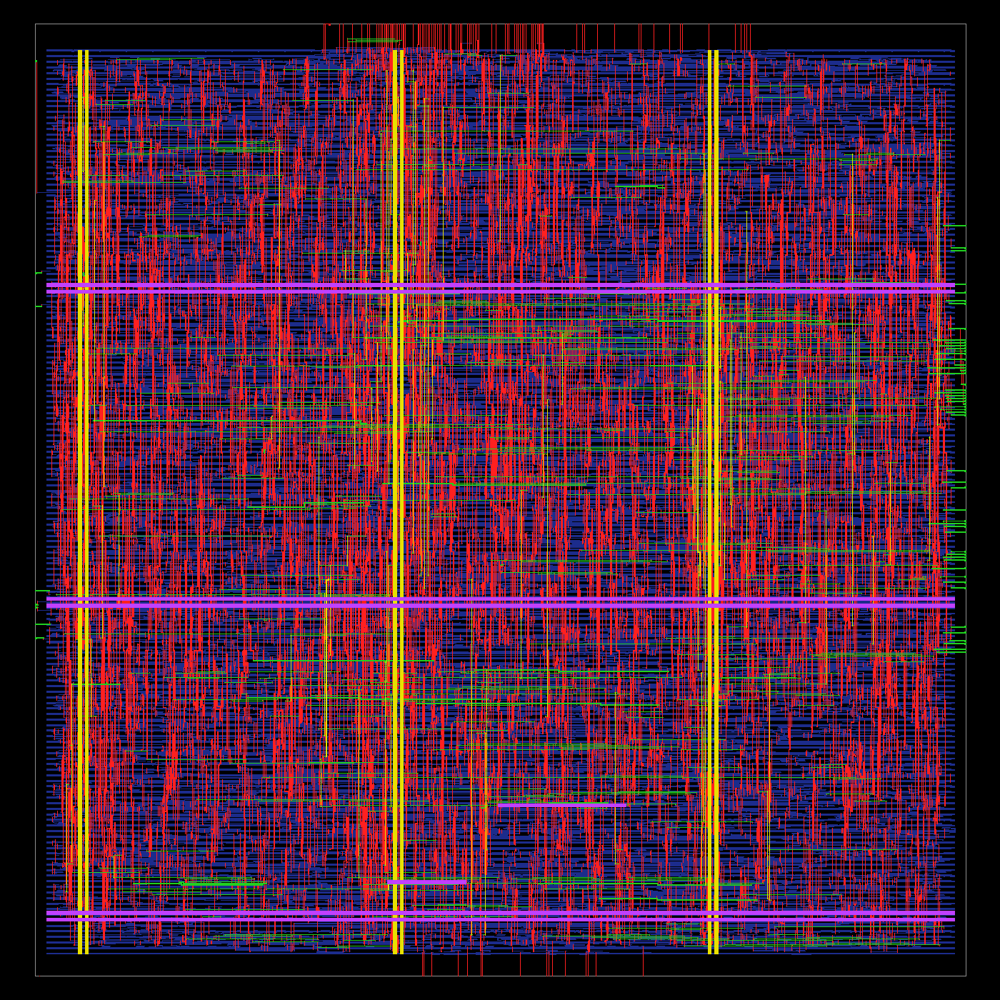
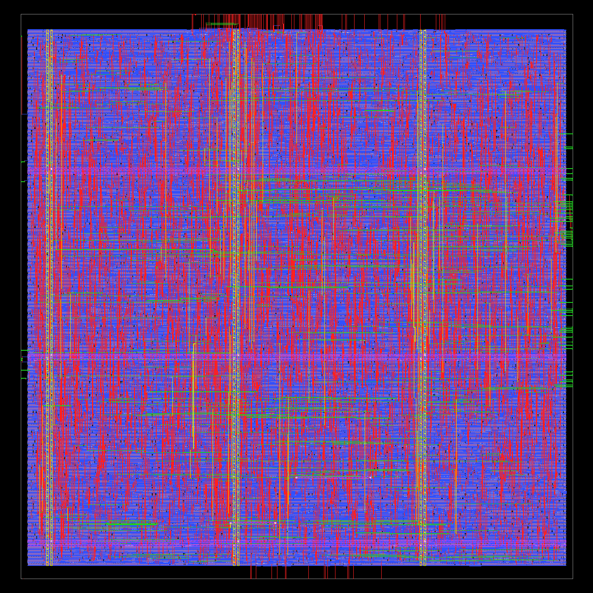
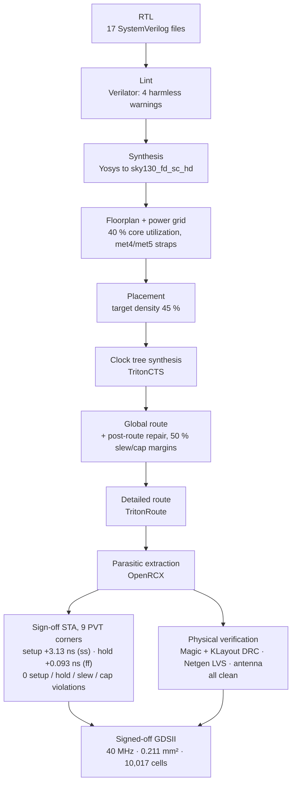

# 5-Stage Pipelined RISC-V Processor (RV32I subset) — SystemVerilog


-informational)

A 32-bit, five-stage pipelined RISC-V processor (**Fetch → Decode → Execute → Memory → Writeback**) with full data forwarding, load-use stall detection and branch/jump flushing, written in synthesizable SystemVerilog. Based on the microarchitecture in *Digital Design and Computer Architecture: RISC-V Edition* (Harris & Harris), implemented, debugged and verified independently, then taken from RTL to a **signed-off SkyWater 130 nm layout** with an open-source ASIC flow.

## Highlights

- **5-stage pipeline** with 4 pipeline registers and a dedicated hazard unit
- **Data forwarding** from the Memory and Writeback stages to both ALU operands, with Memory-stage priority
- **Load-use hazard detection** – 1-cycle stall plus bubble insertion
- **Control hazards** – static not-taken prediction; taken `beq`/`jal` flush 2 slots
- **Self-checking processor testbench** – verified program exercises every hazard type, prints register writes, stores and performance counters (cycles, CPI, stalls, flushes)
- **UVM testbench for the hazard unit** – 1,170 transactions, 0 mismatches, **99.21 % functional coverage**
- **Synthesized** for a Xilinx Zynq-7000 (xc7z010): **~80 MHz** post-synthesis estimate, **636 LUTs**, 0 DSP / 0 BRAM (see [Results](#results))
- **Two pipeline bugs found and fixed** through system-level testing (see [Debugging highlights](#debugging-highlights))
- **ASIC implementation in SkyWater 130 nm**: 40 MHz, **0 setup / hold / slew / cap violations at 9 PVT corners**, DRC / LVS / antenna clean, 0.211 mm², 10,017 cells (see [ASIC implementation](#asic-implementation-skywater-130-nm), [interactive layout viewer](https://ajeeth93.github.io/riscv32i-5stage-pipelined-cpu/layout/))

## ASIC implementation: SkyWater 130 nm

<table>
  <tr>
    <td align="center">
      <a href="https://ajeeth93.github.io/riscv32i-5stage-pipelined-cpu/layout/"></a><br>
      <b>Metal routing</b><br><sub>met1 blue · met2 red · met3 green · met4 yellow · met5 purple</sub>
    </td>
    <td align="center">
      <a href="https://ajeeth93.github.io/riscv32i-5stage-pipelined-cpu/layout/"></a><br>
      <b>All layers</b><br><sub>diffusion, poly, contacts, li1, metals and vias</sub>
    </td>
  </tr>
</table>

**[Open the interactive layout viewer](https://ajeeth93.github.io/riscv32i-5stage-pipelined-cpu/layout/)**: zoom from the whole die down to single transistors, in a **Metal routing** view (met1 blue, met2 red, met3 green, met4 yellow, met5 purple) and an **All layers** view (diffusion, poly, contacts, li1, metals and vias).

The core was hardened with memory ports (instruction and data memories outside the block) and taken to a signed-off GDSII with the open-source **LibreLane 3.0** flow on the **sky130A** PDK. Full report, including constraints, configuration, per-corner timing and the timing-closure story: **[asic/README.md](asic/README.md)**.



| Metric | Result |
|---|---|
| Toolchain | LibreLane 3.0.17: Verilator, Yosys, OpenROAD (TritonCTS, TritonRoute), OpenRCX, OpenSTA, Magic, KLayout, Netgen |
| PDK / cells | SkyWater sky130A / `sky130_fd_sc_hd` |
| Clock | 25 ns (**40 MHz**), signed off at 9 corners (nom / min / max × tt / ss / ff) |
| Worst setup slack | **+3.13 ns** at `max_ss_100C_1v60` |
| Worst hold slack | **+0.093 ns** at `max_ff_n40C_1v95` |
| Violations | **0** setup, hold, max slew and max cap at every corner |
| Physical verification | Magic + KLayout DRC clean, Netgen LVS match, antenna pass |
| Area | 211,001 µm² die (≈ 454 × 465 µm), 92,430 µm² cells, 47.35 % utilization, 10,017 cells |
| Power | 8.95 mW (vectorless estimate) |
| Functional check | Original self-checking testbench passes on the ASIC core (25 cycles, CPI 1.316) |

**Constraints and configuration.** 40 MHz clock with 0.25 ns setup and 0.10 ns hold uncertainty; inputs driven by `sky130_fd_sc_hd__buf_4`, 30 fF output load; 4 ns input/output delay budgets, with a 2.5 ns minimum input delay to cover the ~2.1 ns clock-tree insertion delay. LibreLane runs with 40 % core utilization, 45 % placement density, post-global-route design and timing repair, and 50 % slew/cap repair margins. Files: [`asic/constraint.sdc`](asic/constraint.sdc), [`asic/config.json`](asic/config.json).

**Timing closure in short.** The first full run at 20 ns failed setup by 1.29 ns at the slow corner, so the clock was relaxed to 25 ns. About 880 max-slew violations then remained at ss, on high-fanout register-file read-decode nets. Tightening `set_max_transition` and `set_max_fanout` made timing much worse (setup fell to −5 ns). The root cause was that the resizer repaired against optimistic estimated parasitics; adding post-global-route repair and 50 % slew/cap margins brought all violations to zero and raised setup slack from +1.59 to +3.13 ns. Run-by-run table: [asic/README.md](asic/README.md#timing-closure).

**Signed-off GDSII:** [`asic/final/RISC_V_Pipeline_Top.gds.gz`](asic/final/)

## Architecture


| Stage | Main blocks |
|---|---|
| Fetch | Program counter, PC+4 adder, instruction memory, next-PC mux |
| Decode | Controller (main + ALU decoder), register file (write on falling edge), immediate extension |
| Execute | Forwarding muxes, ALU, branch-target adder, branch decision (`PCSrcE`) |
| Memory | Data memory (64 × 32-bit) |
| Writeback | Result mux (ALU / load data / PC+4) |
| Hazard unit | Forwarding control, load-use stall, flush on taken branch / jump |

### Supported instructions

| Type | Instructions |
|---|---|
| R-type | `add`, `sub`, `and`, `or`, `slt` |
| I-type ALU | `addi`, `andi`, `ori`, `slti` |
| Load / Store | `lw`, `sw` |
| Branch / Jump | `beq`, `jal` |

### Hazard handling

| Hazard | Mechanism | Penalty |
|---|---|---|
| RAW, ALU result needed next instruction | Forward from Memory stage (`ForwardXE = 10`) | 0 cycles |
| RAW, result needed two instructions later | Forward from Writeback stage (`ForwardXE = 01`) | 0 cycles |
| RAW, result needed three instructions later | Register file writes on the falling edge, Decode reads the new value in the same cycle | 0 cycles |
| Load-use | Stall Fetch/Decode, flush Execute | 1 cycle |
| Taken `beq` / `jal` | Flush Decode and Execute | 2 cycles |

## Verification

### 1. Processor-level test (directed, self-checking)

The processor runs [`Test Bench/riscvtest.s`](Test%20Bench/riscvtest.s), a 21-instruction program that deliberately exercises every hazard path: Memory- and Writeback-stage forwarding, a load-use stall, a not-taken and a taken branch, and a `jal`. It passes when the program stores **25 to address 100**. Console output (condensed):

```
REGISTER WRITE: x2 <= 5        REGISTER WRITE: x7 <= 12
REGISTER WRITE: x3 <= 12       REGISTER WRITE: x7 <= 7
REGISTER WRITE: x7 <= 3        STORE: Address=96,  Data=7
REGISTER WRITE: x4 <= 7        REGISTER WRITE: x2 <= 7
REGISTER WRITE: x5 <= 4        REGISTER WRITE: x9 <= 18
REGISTER WRITE: x5 <= 11       REGISTER WRITE: x3 <= 68
REGISTER WRITE: x4 <= 0        REGISTER WRITE: x2 <= 25
REGISTER WRITE: x4 <= 1        STORE: Address=100, Data=25

              SIMULATION PASSED
Cycles 25 · Load-use stalls 1 · Taken branches/jumps 2 (4 flushed slots)
```

The testbench also fails immediately if the program file is not loaded, so a silent "all-`nop`" run cannot be mistaken for a pass.


*Waveform (90–230 ns): the taken `beq` raises `PCSrcE`, `FlushD` and `FlushE` (~115 ns); the `sw` to address 96 coincides with the load-use stall (`lwstall`, `StallF`, `StallD`, ~185 ns); the `jal` causes the second flush (~215 ns). Forwarding selects (`ForwardAE`/`ForwardBE`) and the architectural registers (`sp`, `gp`, `tp`, `t0`, `t2`, `s1`) are shown underneath. The `instruction`/`opcode`/`rd`/`rs1`/`rs2` fields are those of the instruction in **Decode**, one stage behind `PC`/`Instr` in Fetch.*

### 2. UVM verification of the hazard unit

A full UVM 1.2 environment (sequencer, driver, monitor, agent, scoreboard with an independent reference model, coverage collector) runs 17 directed scenarios and 1,000+ constrained-random transactions.

| Metric | Result |
|---|---|
| Transactions checked | 1,170 |
| Scoreboard mismatches | **0** |
| Functional coverage | **99.21 %** |
| UVM errors / fatals | 0 / 0 |

Details, test plan and coverage model: [UVM Verification/README.md](UVM%20Verification/README.md)

### 3. Unit tests

Directed testbenches and waveforms for the PC, PC+4 adder, ALU, decoders, control unit and hazard unit are in [`Simulation & Testing/`](Simulation%20%26%20Testing/).

## Results

### FPGA

**Synthesis** – Vivado 2023.2, Zynq-7000 `xc7z010clg400-1`, out-of-context, 100 MHz constraint:

| Metric | Value |
|---|---|
| Estimated Fmax | **~80 MHz** (WNS −2.48 ns at 10 ns, post-synthesis estimate) |
| LUTs | 636 (556 logic + 80 distributed RAM for data memory) |
| Flip-flops | 492 |
| BRAM / DSP | 0 / 0 |

> Resource numbers include the test program held in on-chip instruction ROM. Because that program only uses registers x2–x9, Vivado trims unused register-file entries, so these figures are a lower bound for the full core. Program-independent core-only numbers are on the roadmap.

**Critical path** (22 logic levels, 12.5 ns): `Rs2E` → forwarding mux → ALU subtraction (carry chain) → `Zero` → `PCSrcE` → next-PC mux → PC register. Branches are resolved in Execute using the ALU, so the branch decision and the PC update share one cycle. That is the main target for frequency improvement.

### ASIC (sky130)

40 MHz, 0 violations at 9 PVT corners, DRC / LVS clean, 0.211 mm², 8.95 mW. See [ASIC implementation](#asic-implementation-skywater-130-nm) and [asic/README.md](asic/README.md). The same branch path (forwarding → ALU → zero-detect → branch decision) is also the critical path in silicon.

## Debugging highlights

System-level testing exposed two bugs that unit and UVM tests of individual blocks could not catch, because both come from how the blocks interact:

1. **Writeback-to-Decode hazard.** With a rising-edge register-file write, an instruction three positions after its producer read a stale value (`or x4, x7, x2` produced 3 instead of 7). The hazard unit only forwards into Execute, so this case is resolved by writing the register file on the falling edge.
2. **First instruction executed twice after reset.** Instructions fetched while reset was held flowed through the un-reset pipeline registers. Fixed by clearing the Fetch/Decode and Decode/Execute registers during reset (`clr = Flush | rst`).

## Repository structure

```
RTL Code/                     SystemVerilog source, one module per file
  RISC_V_Pipeline_Top.sv        top level (ports: clk, rst, PC, Instr, DataAdr, WriteData, MemWrite)
Test Bench/
  RISC-V_Processor_tb.sv        self-checking processor testbench with performance counters
  RISC-Vmem.txt                 program (hex) loaded into instruction memory
  riscvtest.s                   annotated assembly listing of the program
  wave.tcl                      grouped waveform view for Vivado
  HazardUnit_tb.sv              directed hazard-unit testbench
UVM Verification/             UVM environment for the hazard unit
Constraints/clock.xdc         100 MHz clock constraint
RTL Modules and Schematics/   block diagrams
Simulation & Testing/         waveforms
asic/                         ASIC implementation (sky130, LibreLane) - see asic/README.md
  src/                          hardened core with memory ports
  sim/                          riscv_soc wrapper, memories, testbench
  config.json, constraint.sdc   signed-off flow configuration and constraints
  final/                        signed-off GDSII
  *.lyp, *.py, open_layout.sh   KLayout colours, layout rendering, deep-zoom tiles
docs/                         GitHub Pages: interactive layout viewer (docs/layout/)
```

## Running it

### Processor simulation (Vivado)

1. Create an RTL project (part `xc7z010clg400-1`) outside this folder.
2. Add all files in `RTL Code/` as **design sources** and set `RISC_V_Pipeline_Top` as top.
3. Add `Test Bench/RISC-V_Processor_tb.sv` as a **simulation source** and set `testbench` as top.
4. Add the program as a design source and mark it as memory data (Tcl console; double braces because of the space in the path):
   ```tcl
   add_files -fileset sources_1 -norecurse {{<repo>/Test Bench/RISC-Vmem.txt}}
   set_property file_type {Memory Initialization Files} [get_files RISC-Vmem.txt]
   ```
5. Run Behavioral Simulation, then load the grouped waveform:
   ```tcl
   source {<repo>/Test Bench/wave.tcl}
   ```

### UVM testbench

```bash
cd "UVM Verification"
./run_xsim.sh          # 170 directed + 1000 random transactions
```

### ASIC flow (LibreLane)

```bash
python3 -m librelane --dockerized asic/config.json   # from the repository root
./asic/open_layout.sh                                # view the signed-off GDS in KLayout
```

Details: [asic/README.md](asic/README.md#reproducing-the-results)

### Synthesis

1. Add `Constraints/clock.xdc` as a constraint.
2. Settings → Synthesis → More Options: `-mode out_of_context`
3. Run Synthesis → Open Synthesized Design → `report_utilization`, `report_timing_summary`.

## Roadmap

- [ ] Program-independent, post-route resource and timing numbers (core with external instruction port)
- [ ] Dedicated branch comparator to shorten the critical path
- [ ] Remaining RV32I instructions (`bne`, `blt`, `jalr`, `lui`, `auipc`, shifts, byte/half loads and stores)
- [ ] Longer benchmarks (sorting, loops) and `riscv-tests` for compliance and steady-state CPI
- [x] ASIC implementation: RTL-to-GDSII in sky130 with LibreLane, signed off at 40 MHz ([asic/README.md](asic/README.md))
- [ ] ASIC follow-ups: gate-level simulation with SDF, IR-drop and clock-tree analysis, workload-based power, branch comparator for ~50 MHz

## Acknowledgments

Microarchitecture based on *Digital Design and Computer Architecture: RISC-V Edition* by Sarah L. Harris and David Money Harris.
