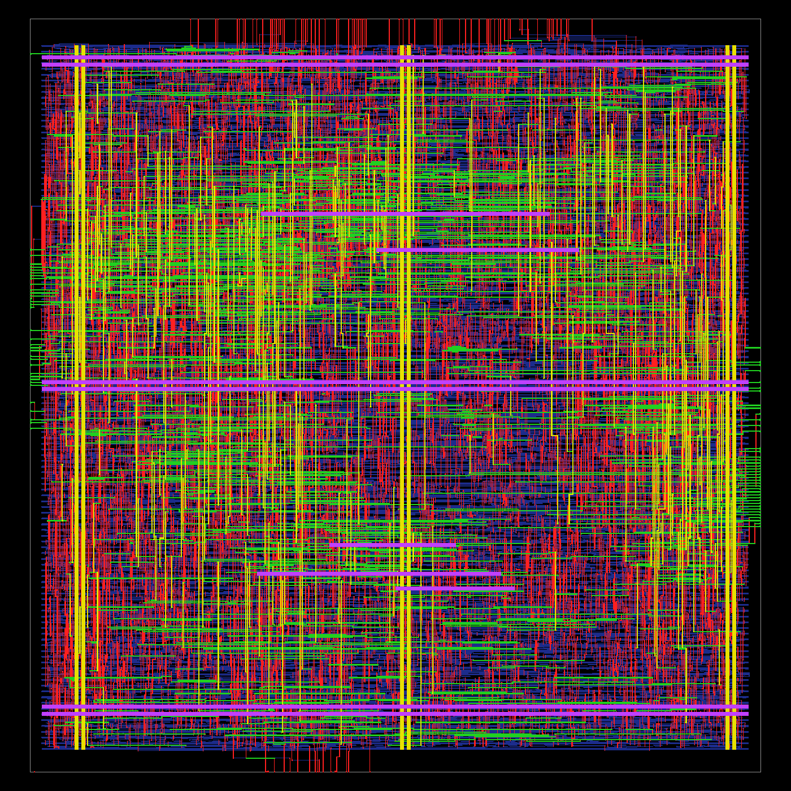
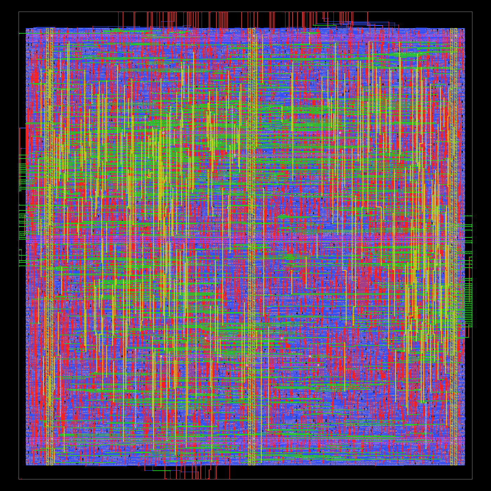
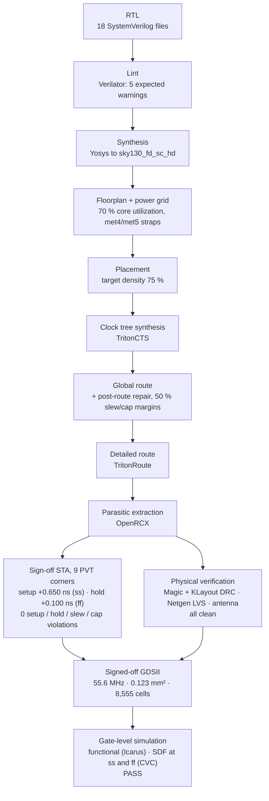
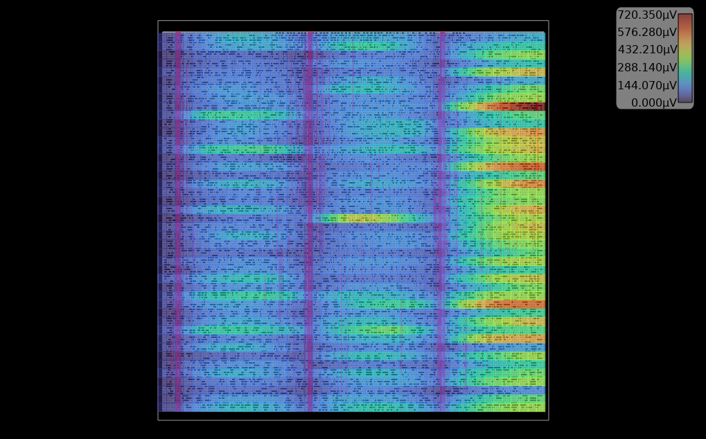

# ASIC Implementation: RV32I Core in SkyWater 130 nm

<table>
  <tr>
    <td align="center">
      <a href="https://ajeeth93.github.io/riscv32i-5stage-pipelined-cpu/layout/"></a><br>
      <b>Metal routing</b><br><sub>met1 blue · met2 red · met3 green · met4 yellow · met5 purple</sub>
    </td>
    <td align="center">
      <a href="https://ajeeth93.github.io/riscv32i-5stage-pipelined-cpu/layout/"></a><br>
      <b>All layers</b><br><sub>diffusion, poly, contacts, li1, metals and vias</sub>
    </td>
  </tr>
</table>

**[Open the interactive layout viewer](https://ajeeth93.github.io/riscv32i-5stage-pipelined-cpu/layout/)**: zoom from the whole die down to single transistors, in a **Metal routing** view and an **All layers** view.

The 5-stage RV32I core was taken from RTL to a signed-off GDSII with the open-source **LibreLane** flow (Yosys + OpenROAD + Magic/KLayout/Netgen) on the **SkyWater sky130A** PDK. It closes timing at **55.6 MHz with zero setup, hold, slew and capacitance violations at all 9 PVT corners**, passes DRC, LVS and antenna checks, and runs its test program correctly in **gate-level simulation with SDF delays** at the slowest and fastest corners.

The work was done in two rounds:

- **v1 (October 2026):** first sign-off at 40 MHz, after an eight-run timing-closure effort ([Timing closure (v1)](#timing-closure-v1)).
- **v2 (November 2026):** critical path traced with STA and SDF gate-level simulation, a dedicated branch comparator added (+22 % Fmax), and a utilization sweep (−42 % die area) ([Timing optimisation (v2)](#timing-optimisation-v2)).

## v1 → v2 at a glance

| | v1 | v2 |
|---|---|---|
| Clock (signed off) | 25 ns (40 MHz) | **18 ns (55.6 MHz)** |
| Design limit at the slow corner | ≈ 21.9 ns (45.7 MHz) | ≈ 17.6 ns (56.8 MHz); a 17 ns run fails setup by 0.60 ns |
| Worst setup / hold slack | +3.13 / +0.093 ns | **+0.650 / +0.100 ns** |
| Die area | 211,001 µm² | **122,580 µm² (≈ 345 × 356 µm, −42 %)** |
| Standard cells | 10,017 cells, 92,430 µm² | 8,555 cells, 89,187 µm² (−3.5 %) |
| Final utilization | 47.35 % | 80.6 % |
| Power (vectorless estimate) | 8.95 mW at 40 MHz | 12.32 mW at 55.6 MHz |
| Gate-level simulation | – | Functional PASS; SDF timing (CVC) PASS at ss and ff, 0 timing-check violations |
| IR drop (static) | not analysed | 1.4 mV worst (0.08 % of 1.8 V) |

Full record, including predictions versus results for every step: [`V2_LOG.md`](V2_LOG.md).

## Contents

- [Results at a glance](#results-at-a-glance)
- [What was hardened](#what-was-hardened)
- [Toolchain](#toolchain)
- [Flow](#flow)
- [Constraints (SDC)](#constraints-sdc)
- [Final configuration](#final-configuration)
- [Sign-off: timing at 9 corners](#sign-off-timing-at-9-corners)
- [Sign-off: area, power and physical checks](#sign-off-area-power-and-physical-checks)
- [Gate-level simulation](#gate-level-simulation)
- [IR drop](#ir-drop)
- [Timing optimisation (v2)](#timing-optimisation-v2)
- [Timing closure (v1)](#timing-closure-v1)
- [Layout viewer: metal routing and all layers](#layout-viewer-metal-routing-and-all-layers)
- [Reproducing the results](#reproducing-the-results)
- [Files](#files)
- [Limitations and next steps](#limitations-and-next-steps)

## Results at a glance

| Metric | Result |
|---|---|
| Technology | SkyWater sky130A, standard cells `sky130_fd_sc_hd` |
| Clock | **18 ns (55.6 MHz)** |
| Sign-off corners | 9: nom / min / max parasitics × tt / ss / ff |
| Worst setup slack | **+0.650 ns** (`max_ss_100C_1v60`) |
| Worst hold slack | **+0.100 ns** (`max_ff_n40C_1v95`) |
| Setup / hold / max-slew / max-cap violations | **0 / 0 / 0 / 0** at every corner |
| DRC (route, Magic, KLayout) | 0 / 0 / 0 |
| LVS (Netgen) | Match |
| Antenna | Pass |
| Die area | 122,580 µm² (≈ 345 × 356 µm, 0.123 mm²) |
| Standard-cell area | 89,187 µm² |
| Utilization | 80.6 % (setting 70 %; buffers, hold cells and clock tree are added after floorplanning) |
| Cells | 8,555 (logic, clock tree and buffers, excluding fill and decap) |
| Power | 12.32 mW at 55.6 MHz (vectorless, default switching activity) |
| RTL simulation | Self-checking testbench passes on the ASIC core: 25 stored to address 100, 25 cycles, CPI 1.316 |
| Gate-level simulation | Functional (Icarus) PASS; SDF-annotated (CVC) PASS at `max_ss` and `min_ff`, 0 timing-check violations |

## What was hardened

The hardened block is the **core alone**. Instruction and data memories sit outside it and connect through memory ports, the usual way a CPU core is hardened before caches or SRAM macros are added.

| Port | Width | Direction | Purpose |
|---|---|---|---|
| `clk`, `rst` | 1 | in | Clock, reset |
| `imem_addr` | 32 | out | Instruction address (PC) |
| `imem_rdata` | 32 | in | Instruction |
| `dmem_addr` | 32 | out | Data address (ALU result) |
| `dmem_wdata` | 32 | out | Store data |
| `dmem_rdata` | 32 | in | Load data |
| `dmem_we` | 1 | out | Write enable |
| `dmem_req` | 1 | out | Access request (load or store) |
| `dmem_ready` | 1 | in | Reserved for a future cache stall (not used yet) |

165 pins in total. Differences from the FPGA version in [`RTL Code/`](../RTL%20Code/):

- `RISC_V_Pipeline_Top` exposes memory ports instead of instantiating the memories; `dmem_req = MemWriteM | (ResultSrcM == 2'b01)`.
- **v2: `beq` is decided by a dedicated comparator** ([`src/RISC_V_Pipeline_BranchComparator.sv`](src/RISC_V_Pipeline_BranchComparator.sv)) on the forwarded operands: `PCSrcE = (BranchE & EqE) | JumpE`. The FPGA version still uses the ALU's `Zero` flag.
- The register file's zero-initialisation `initial` block is wrapped in `` `ifndef SYNTHESIS ``.
- Reset styles as synthesized: PC asynchronous, Fetch/Decode and Decode/Execute synchronous clear, Execute/Memory and Memory/Writeback without reset.
- A simulation wrapper, [`sim/riscv_soc.sv`](sim/riscv_soc.sv), puts the core and both memories back together so the original self-checking testbench still runs unchanged.

## Toolchain

| Step | Tool |
|---|---|
| Flow manager | LibreLane 3.0.17 (run with `--dockerized`) |
| Lint | Verilator |
| Synthesis | Yosys |
| Floorplan, PDN, placement, CTS, resizer, routing | OpenROAD (TritonCTS, global route, TritonRoute) |
| Parasitic extraction | OpenRCX |
| Static timing analysis | OpenSTA, 9 corners (plus a custom script, [`sta_rise.tcl`](sta_rise.tcl), to split paths by capture edge) |
| IR drop | OpenROAD PSM (static), heat map in the OpenROAD GUI |
| DRC | Magic and KLayout |
| LVS | Netgen |
| PDK | sky130A installed with Ciel |
| RTL simulation | Vivado 2023.2 xsim, Icarus Verilog 12 |
| Gate-level simulation | Icarus Verilog 12 (functional, unit delay), OSS CVC 7.00b (SDF-annotated) |
| Layout viewing and rendering | KLayout, OpenSeadragon (web viewer) |
| Host | Windows laptop, WSL2 Ubuntu + Docker Desktop |

## Flow



The lint warnings are all expected: `dmem_ready` is not used yet, and `lwstall`, `ResultSrcE[1]` and `InstrD[6:0]` are partially unused signals (4 in v1). v2 adds one, from the ALU's `Zero` output, which is deliberately left unconnected since the branch comparator took over.

## Constraints (SDC)

[`constraint.sdc`](constraint.sdc), used for both place-and-route and sign-off. Since v2 the clock period comes from `CLOCK_PERIOD` in the config, so one number sets the target:

```tcl
# RV32I core - sky130 - clock period from CONFIG CLOCK_PERIOD (v2: 18 ns, 55.6 MHz)

# 1. Clock
set clk_period $::env(CLOCK_PERIOD)
create_clock -name clk -period $clk_period -waveform [list 0.0 [expr {$clk_period / 2.0}]] [get_ports clk]
set_clock_latency -source -early 0.10 [get_clocks clk]
set_clock_latency -source -late  0.20 [get_clocks clk]
set_clock_uncertainty -setup 0.25 [get_clocks clk]
set_clock_uncertainty -hold  0.10 [get_clocks clk]
set_clock_transition 0.15 [get_clocks clk]

# 2. Drive and load
set in_ports [delete_from_list [all_inputs] [get_ports clk]]
set_driving_cell -lib_cell sky130_fd_sc_hd__buf_4 $in_ports
set_load -pin_load 0.03 [all_outputs]

# 3. I/O budgets
set_input_delay  -max 4.0 -clock clk $in_ports
set_input_delay  -min 2.5 -clock clk $in_ports
set_output_delay -max 4.0 -clock clk [all_outputs]
set_output_delay -min 1.0 -clock clk [all_outputs]

# 4. Exceptions
set_false_path -from [get_ports rst]
set_false_path -from [get_ports dmem_ready]
```

Why these values:

- **Minimum input delay 2.5 ns.** In v1 the clock tree delayed the flip-flop clocks by about 2.1 ns. With a 1.5 ns minimum input delay, input data reached 22 flops before their own clock edge and violated hold.
- **I/O budget of 4 ns out of 18 ns** on each side leaves the external memories 22 % of the cycle. It was kept fixed from v1: the external memory does not get faster when the core does.
- **False paths:** `rst` is treated as quasi-static, and `dmem_ready` is not connected to logic yet.
- **No `set_max_fanout` or `set_max_transition`.** Both were tried in v1 and both made timing much worse (see [Timing closure (v1)](#timing-closure-v1)).

## Final configuration

[`config.json`](config.json):

```json
{
  "DESIGN_NAME": "RISC_V_Pipeline_Top",
  "VERILOG_FILES": "dir::src/*.sv",
  "CLOCK_PORT": "clk",
  "CLOCK_PERIOD": 18,
  "PNR_SDC_FILE": "dir::constraint.sdc",
  "SIGNOFF_SDC_FILE": "dir::constraint.sdc",
  "FP_CORE_UTIL": 70,
  "PL_TARGET_DENSITY_PCT": 75,
  "RUN_POST_GRT_DESIGN_REPAIR": true,
  "RUN_POST_GRT_RESIZER_TIMING": true,
  "GRT_DESIGN_REPAIR_MAX_SLEW_PCT": 50,
  "GRT_DESIGN_REPAIR_MAX_CAP_PCT": 50,
  "DESIGN_REPAIR_MAX_SLEW_PCT": 50,
  "DESIGN_REPAIR_MAX_CAP_PCT": 50
}
```

| Setting | Why |
|---|---|
| `CLOCK_PERIOD` 18 | Fastest period that closes after the branch comparator; 17 ns fails setup by 0.60 ns at ss. (v1 used 25 ns because 20 ns failed by 1.29 ns.) |
| `FP_CORE_UTIL` 70, `PL_TARGET_DENSITY_PCT` 75 | Chosen by a utilization sweep (40–70 %): smallest die that still closes cleanly; final utilization 80.6 % |
| `RUN_POST_GRT_DESIGN_REPAIR`, `RUN_POST_GRT_RESIZER_TIMING` | Repair slew, cap and timing again once real global routes exist |
| `*_MAX_SLEW_PCT` / `*_MAX_CAP_PCT` 50 | Margin against parasitics that the pre-route estimate underestimates (default 10 %) |

Floorplan, power grid (met4 vertical and met5 horizontal straps) and clock tree use LibreLane defaults.

## Sign-off: timing at 9 corners

Post-route STA with extracted parasitics, v2 (18 ns, 70 % utilization):

| Corner | Setup WS (ns) | Hold WS (ns) |
|---|---|---|
| `max_ss_100C_1v60` | **+0.650** | +0.554 |
| `nom_ss_100C_1v60` | +0.980 | +0.556 |
| `min_ss_100C_1v60` | +1.299 | +0.558 |
| `max_tt_025C_1v80` | +5.345 | +0.222 |
| `nom_tt_025C_1v80` | +5.442 | +0.223 |
| `min_tt_025C_1v80` | +5.546 | +0.224 |
| `max_ff_n40C_1v95` | +6.630 | **+0.100** |
| `nom_ff_n40C_1v95` | +6.688 | +0.101 |
| `min_ff_n40C_1v95` | +6.751 | +0.101 |

The slow-slow corners set the frequency; fast-fast sets the hold margin. Setup and hold violations: 0 at every corner.

**Critical setup paths (v2).**

- **Full cycle:** forwarding detection (`Rs2E` compared with `RdM`/`RdW`, ≈ 4.4 ns) → forwarding mux → comparator XOR + OR tree → `PCSrcE` → `FlushE` fanout to every Decode/Execute bit. Arrival 18.7 ns at 25 ns before the sweep (v1: 23.1 ns through the ALU and zero detect, ending at the PC).
- **Half cycle:** writeback result → register file, which writes on the falling edge (Harris & Harris style). Allows ≈ 13.8 ns, so it is not yet the limit.

**Frequency headroom:** v2 is signed off at 55.6 MHz; a 17 ns run failed setup by 0.60 ns, so the limit is ≈ 17.6 ns at ss. Typical corner: ≈ 80 MHz.

<details>
<summary>v1 sign-off per corner (25 ns, 40 % utilization)</summary>

| Corner | Setup WNS (ns) | Hold WNS (ns) | Setup / hold violations | Max slew / cap violations |
|---|---|---|---|---|
| max_ss_100C_1v60 | **+3.128** | +0.543 | 0 / 0 | 0 / 0 |
| nom_ss_100C_1v60 | +3.418 | +0.548 | 0 / 0 | 0 / 0 |
| min_ss_100C_1v60 | +3.671 | +0.551 | 0 / 0 | 0 / 0 |
| max_tt_025C_1v80 | +8.902 | +0.214 | 0 / 0 | 0 / 0 |
| nom_tt_025C_1v80 | +8.997 | +0.217 | 0 / 0 | 0 / 0 |
| min_tt_025C_1v80 | +9.099 | +0.220 | 0 / 0 | 0 / 0 |
| max_ff_n40C_1v95 | +10.176 | **+0.093** | 0 / 0 | 0 / 0 |
| nom_ff_n40C_1v95 | +10.234 | +0.097 | 0 / 0 | 0 / 0 |
| min_ff_n40C_1v95 | +10.299 | +0.098 | 0 / 0 | 0 / 0 |

v1 critical path: writeback result → forwarding mux → ALU → 32-bit zero-detect OR tree → `PCSrcE` → next PC.

</details>

## Sign-off: area, power and physical checks

| Check | v2 | v1 |
|---|---|---|
| Die area | 122,580 µm² | 211,001 µm² |
| Standard-cell area | 89,187 µm² | 92,430 µm² |
| Utilization | 80.6 % | 47.35 % |
| Cell count | 8,555 | 10,017 |
| Total power (vectorless, default activity) | 12.32 mW at 55.6 MHz | 8.95 mW at 40 MHz |
| Route / Magic / KLayout DRC | 0 / 0 / 0 | 0 / 0 / 0 |
| Netgen LVS | Netlists match | Netlists match |
| Antenna check | Pass | Pass |
| GDS (gzipped, in [`final/`](final/)) | 2.8 MB | 2.9 MB |

Standard-cell area is `design__instance__area__stdcell` (excludes fill and decap cells); die area is the full block outline.

## Gate-level simulation

The routed netlist from the final run is simulated with the same test program as the RTL. The testbench checks only the ports, because the netlist is flattened and internal RTL names no longer exist.

| Simulation | Netlist / delays | Clock | Result |
|---|---|---|---|
| Functional ([`sim/run_gls.sh`](sim/run_gls.sh)) | `final/nl` + `sky130_fd_sc_hd` models, unit delay (Icarus 12) | 25 ns | PASS, 25 cycles |
| SDF, slowest corner ([`sim/cvc/run_cvc.sh`](sim/cvc/run_cvc.sh)) | `final/pnl` + `max_ss_100C_1v60` SDF (CVC) | 18 ns | PASS, 0 timing-check violations |
| SDF, fastest corner | `final/pnl` + `min_ff_n40C_1v95` SDF (CVC) | 18 ns | PASS, 0 timing-check violations |

Notes from getting there:

- **Icarus cannot simulate the sky130 timing models.** They drive every flip-flop through `*_delayed` copies of D and CLK that only the `$setuphold` timing check creates. Icarus does not support timing checks, so those signals are never driven.
- **CVC has the same gap**, so [`sim/cvc/patch_delayed.py`](sim/cvc/patch_delayed.py) adds `assign X_delayed = X;` for exactly the names inside `$setuphold`/`$recrem`, in a copy of the library. SDF `IOPATH`/`INTERCONNECT` delays and the basic setup/hold checks still work. 66 SDF RECOVERY/REMOVAL entries have no matching check in the cell model; those are covered by STA.
- **Clock sweep with SDF on the v1 netlist:** the slow corner passed down to 20 ns and failed at 19 and 18 ns. The first violations were on the PC and Decode/Execute flops, all fed by the branch decision, which is the same weak spot as STA found. Simulation passed below the STA limit because a 25-cycle program does not exercise every path: **STA is the timing sign-off, simulation confirms the exercised paths.**

## IR drop

Static IR drop with OpenROAD PSM (typical corner, vectorless power) on the v1 layout: **VPWR 0.72 mV, VGND 0.68 mV worst, about 1.4 mV combined (0.08 % of 1.8 V)** against a 90 mV (5 %) budget. The core draws only about 4 mA, so the default power grid is over-designed.



The met1 map shows one band per standard-cell row, the lowest drop under the met4 straps, and the worst drop at the right edge, where the last strap feeds the rails from one side only (drop ∝ L²/2 instead of L²/8 for a rail fed from both ends). Limits: static analysis only, typical corner, estimated activity, and no power-pad locations were given (`VSRC_LOC_FILES`).

## Timing optimisation (v2)

**1. Find the real critical path.** The v1 slow-corner path, read cell by cell from `max.rpt`:

| Segment | Time |
|---|---|
| Clock tree + clock-to-Q (`Rs2E`) | 2.4 ns |
| Forwarding detection → `ForwardBE` | 4.3 ns |
| Forwarding mux + ALUSrc mux | 1.8 ns |
| ALU subtract | 4.4 ns |
| 32-bit zero detect | 6.6 ns |
| Branch logic → `PCSrcE` + fanout | 2.0 ns |
| Next-PC mux → PC register | 1.6 ns |
| **Arrival** | **23.1 ns** |

SDF gate-level simulation pointed at the same place independently: its first setup violations at 18 ns were on the PC and Decode/Execute flops, which are all fed by `PCSrcE`.

**2. Fix it in RTL.** The core supports only `beq`, so the branch decision is just equality. A dedicated comparator on the forwarded operands (`EqE = SrcAE == WriteDataE`) runs in parallel with the ALU, and `PCSrcE = (BranchE & EqE) | JumpE`. The ALU's zero detect became unused and was removed by synthesis. RTL simulation: same result and same 25 cycles (the branch is still decided in Execute; only the logic inside that cycle got shorter).

**3. Measure.** At the unchanged 25 ns, the worst full-cycle slack rose from +3.13 to **+7.42 ns** (arrival 18.7 ns). LibreLane's report lists only the 10 worst paths, which were all half-cycle register-file paths, so [`sta_rise.tcl`](sta_rise.tcl) re-ran OpenSTA split by capture edge to find the full-cycle path. Predicted limit: 25 − 7.42 ≈ 17.6 ns.

**4. Sweep clock and utilization** ([`sweep.sh`](sweep.sh), one config copy per experiment):

| Run | Clock | Util setting | Setup WS | Setup viol. | Hold WS | DRC / LVS | Die µm² | Final util | Power* |
|---|---|---|---|---|---|---|---|---|---|
| base | 18 ns | 40 % | +0.373 | 0 | +0.098 | 0 / 0 | 209,662 | 47.4 % | 12.88 mW |
| clk17 | 17 ns | 40 % | −0.596 | 88 | +0.093 | 0 / 0 | 209,662 | 47.5 % | 13.64 mW |
| u50 | 18 ns | 50 % | +0.499 | 0 | +0.098 | 0 / 0 | 169,143 | 58.4 % | 12.60 mW |
| u60 | 18 ns | 60 % | +0.895 | 0 | +0.106 | 0 / 0 | 142,025 | 69.5 % | 12.42 mW |
| **u70 (final)** | **18 ns** | **70 %** | **+0.650** | **0** | **+0.100** | **0 / 0** | **122,580** | **80.6 %** | **12.32 mW** |

*vectorless estimate

- The 18 ns base run confirmed the prediction exactly: 18 − 0.373 ≈ 17.6 ns. 17 ns failed with 88 violations.
- Packing tighter **improved** setup slack up to 60 % (shorter wires, less capacitance) and lowered power slightly; at 70 % congestion cost a little, still clean.
- The final layout also needs 1,354 fewer cells than the 40 % layout, because shorter wires need fewer buffers.

**Result:** design limit from 45.7 to 55.6 MHz (+22 %), die −42 %, standard-cell area −3.5 %.

## Timing closure (v1)

Eight runs over four days took the v1 design from failing to clean. The decisive change was giving the resizer margin against parasitics that it underestimated; the two constraint-based fixes made things worse.

| Run | Change | Worst setup (ss) | Worst hold | Max slew / cap violations |
|---|---|---|---|---|
| 1 | Synthesis only, 20 ns | – | – | – |
| 2 | First full run: 20 ns clock, min input delay 1.5 ns | −1.29 ns (776 paths) | −0.077 ns (22 I/O paths) | 804 / 34 |
| 3 | 25 ns clock, min input delay 2.5 ns | +1.28 ns | +0.099 ns | 876 / 37 (ss) |
| 4 | + `set_max_fanout 10` + `set_max_transition 1.0` | −5.21 ns (918 paths) | +0.102 ns | 1,875 / 51 |
| 5 | `set_max_fanout 10` only | −4.84 ns (917 paths) | +0.098 ns | 1,172 / 125 (ss) |
| 6 | Run 3 SDC + post-global-route design and timing repair | +1.42 ns | +0.094 ns | 887 / 37 (ss) |
| 7 | + 50 % slew/cap margins in post-global-route repair | +1.59 ns | +0.096 ns | 556 / 26 (ss) |
| 8 **(v1 sign-off)** | + 50 % slew/cap margins in pre-route repair | **+3.13 ns** | **+0.093 ns** | **0 / 0** |

**What happened:**

1. **50 MHz did not fit.** At 20 ns the forwarding → ALU → zero-detect → branch path failed setup at ss by 1.29 ns, so the clock was relaxed to 25 ns. (v2 removed that path; see above.)
2. **Hold failed on 22 input paths.** The clock tree adds about 2.1 ns of insertion delay at the flops, so data with a 1.5 ns minimum input delay arrived before the capturing clock. Raising the minimum input delay to 2.5 ns fixed it.
3. **About 880 slew and 37 cap violations remained at the slow corner.** They clustered on the register-file read-decode nets, for example an `or4_2` driving 32 loads and a `nor2_4` driving 17 loads. A NOR gate's rising edge is slow because of its series PMOS stack.
4. **Tightening constraints backfired.** `set_max_transition` and `set_max_fanout` made the resizer insert buffers everywhere; setup fell to about −5 ns and slew violations doubled.
5. **A wrong hypothesis was ruled out.** The resizer was suspected of seeing fewer corners than STA, but it uses all 9.
6. **Root cause: optimistic estimated parasitics.** Post-route repair initially fixed 0 of 7,178 nets, and the log showed about 2,000 "missing route to pin" estimation warnings. Repair before routing judged slew on estimated wire RC; the real routes were longer, so nets that looked fine failed after routing.
7. **Fix: margins.** 50 % slew/cap margins in post-route repair cut the violations to 556 / 26; adding the same margins before routing took them to 0 / 0.
8. **Setup improved as a side effect**, from +1.59 to +3.13 ns, because sharper edges also shorten downstream cell delays.

**Lessons:** over-constraining design-rule limits makes the resizer chase symptoms with buffers; when repair cannot see a problem, check which parasitics it is using; slew closure and timing closure are coupled; and the high-fanout nets come from the register-file architecture, so the lasting fix is in RTL or floorplan, not in constraints.

## Layout viewer: metal routing and all layers

**[ajeeth93.github.io/riscv32i-5stage-pipelined-cpu/layout](https://ajeeth93.github.io/riscv32i-5stage-pipelined-cpu/layout/)** (v2 layout)

| View | Layers | Purpose |
|---|---|---|
| **Metal routing** | met1 blue, met2 red, met3 green, met4 yellow, met5 purple (solid) | Routing and power grid, Innovus-style colours |
| **All layers** | nwell, diff, tap, poly, contacts, li1, met1–met5 and vias (hatched metals) | Transistor-level detail inside the standard cells |

What to look for:

- **Power grid:** vertical met4 strap pairs (yellow) and horizontal met5 strap pairs (purple) feed the met1 rails of every standard-cell row.
- **Signal routing:** met2 (red) carries most vertical routing and met3 (green) the horizontal; met4 carries only a few long signal routes.
- **Density:** at 80.6 % utilization the cell rows are almost full; compare with the v1 images in the git history.
- **Pins:** the memory-port pins sit along the block edges.
- **All layers, zoomed in:** diffusion and poly form the transistors; li1 and met1 wire them inside each cell.

How it is built: KLayout renders the GDS into 256 × 256 px WebP tiles at every zoom level ([`make_deepzoom.py`](make_deepzoom.py)), and [OpenSeadragon](https://openseadragon.github.io/) loads only the tiles in view. Full zoom is 12,500 px across the v2 die, 27.6 nm per pixel, with 3,396 tiles per view (v1: 16,384 px and 5,661 tiles for the larger die, at the same scale). The page lives in [`docs/layout/`](../docs/layout/) and is served by GitHub Pages.

## Reproducing the results

Requirements: Linux or WSL2, Docker, Python 3.10+, LibreLane 3.x (`pip install librelane`). The sky130A PDK is fetched automatically on the first run.

```bash
# from the repository root
python3 -m librelane --dockerized asic/config.json
```

Results land in `asic/runs/<RUN_TAG>/` (git-ignored). Useful outputs:

```bash
cat asic/runs/<RUN_TAG>/*-openroad-stapostpnr/summary.rpt   # 9-corner timing summary
ls  asic/runs/<RUN_TAG>/final/                              # gds, netlist, sdf, spef, metrics.csv
```

Clock / utilization sweep (one named run per experiment, about 18 minutes each):

```bash
./asic/sweep.sh
```

Gate-level simulation (edit the run folder in `run_gls.sh`; `run_cvc.sh` takes it as the third argument):

```bash
./asic/sim/run_gls.sh                                          # functional, Icarus
python3 asic/sim/cvc/patch_delayed.py <pdk>/sky130_fd_sc_hd.v asic/sim/cvc/cells/sky130_fd_sc_hd_patched.v
./asic/sim/cvc/run_cvc.sh max_ss_100C_1v60 18 <run-folder>     # SDF, setup corner
./asic/sim/cvc/run_cvc.sh min_ff_n40C_1v95 18 <run-folder>     # SDF, hold corner
```

RTL simulation of the ASIC core with Icarus:

```bash
cd asic/sim
iverilog -g2012 -o rtl.vvp ../src/*.sv InstructionMemory.sv DataMemory.sv riscv_soc.sv RISC-V_Processor_tb.sv
vvp rtl.vvp
```

View the signed-off layout in KLayout with Innovus-style colours:

```bash
./asic/open_layout.sh
```

Regenerate the README images and the web viewer tiles (needs KLayout's Python module and Pillow):

```bash
G=asic/runs/<RUN_TAG>/final/gds/RISC_V_Pipeline_Top.gds
python3 asic/render_innovus.py $G docs/img/chip_innovus.png 1400
python3 asic/render_lyp.py     $G asic/innovus_detail.lyp docs/img/chip_all_layers.png 1400
python3 asic/make_deepzoom.py  $G asic/innovus.lyp        docs/layout metals 12500
python3 asic/make_deepzoom.py  $G asic/innovus_detail.lyp docs/layout detail 12500
```

## Files

```
asic/
  src/                        18 SystemVerilog files of the hardened core
    RISC_V_Pipeline_BranchComparator.sv   v2 branch comparator
  sim/                        riscv_soc wrapper, memories, testbenches, program
    tb_gls.sv, run_gls.sh       functional gate-level simulation (Icarus)
    run_gls_sdf.sh              Icarus SDF attempt (documents why it cannot work)
    cvc/                        SDF gate-level simulation with CVC
      run_cvc.sh, tb_gls_cvc.v, patch_delayed.py
  config.json                 LibreLane configuration (signed off, v2)
  constraint.sdc              timing constraints (clock period from the config)
  sweep.sh                    clock / utilization sweep
  sta_rise.tcl                OpenSTA paths split by capture edge
  V2_LOG.md                   v2 engineering log: every step, prediction vs result
  final/
    RISC_V_Pipeline_Top.gds.gz   signed-off GDSII (v2)
  innovus.lyp                 KLayout colours, metals only (Innovus style)
  innovus_detail.lyp          KLayout colours, all layers
  open_layout.sh              open the GDS in KLayout with innovus.lyp
  render_innovus.py           render the metal-routing PNG
  render_lyp.py               render a PNG with any .lyp file
  make_deepzoom.py            render deep-zoom tiles for the web viewer
docs/
  layout/                     web viewer (index.html, metals and detail tiles)
  img/chip_innovus.png        metal-routing preview
  img/chip_all_layers.png     all-layers preview
  img/irdrop_met1_vpwr.png    IR-drop heat map
```

## Limitations and next steps

Honest scope of the v2 sign-off:

- **55.6 MHz is still modest** for RV32I in sky130. The next limits are forwarding detection (≈ 4.4 ns at the start of the critical path) and the `FlushE` fanout to every Decode/Execute bit.
- **Hold margin at the fast corner is small** (+0.100 ns), though positive at every corner.
- **Gate-level simulation covers one 25-cycle program.** It confirms the exercised paths with real delays; STA remains the timing sign-off. The CVC run needs a patched copy of the cell library.
- **Power is a vectorless estimate**, not a workload-based number, and no power-reduction techniques (clock gating) are used yet.
- **Power grid and clock tree use tool defaults.** Static IR drop is tiny (1.4 mV), so the grid is over-designed; no dynamic IR-drop analysis.
- **Memories are outside the core.**
- **Signal-integrity (crosstalk) analysis** is not available in OpenSTA.

Planned work:

- [x] IR-drop analysis (v2: static, 1.4 mV worst)
- [x] Gate-level simulation: functional and SDF at ss and ff (v2)
- [x] Dedicated branch comparator off the ALU path (v2: 55.6 MHz signed off)
- [x] Utilization sweep (v2: 40–70 %, final 70 %)
- [ ] Forwarding selects computed in Decode and registered, to shorten the start of the critical path
- [ ] Justified power-grid design (strap pitch and width versus worst drop)
- [ ] Clock-tree analysis: skew, insertion latency, buffer count
- [ ] RC-correlation study: slack and slew at placement estimate, global route and extracted SPEF
- [ ] Hand floorplan with pins grouped by function
- [ ] Clock gating and workload-based power from a VCD
- [ ] Integration with the [direct-mapped write-back cache](https://github.com/Ajeeth93/direct-mapped-writeback-cache) and SRAM macros (next project, with a clean-room rebuild of the flow)
- [ ] Same RTL through the Cadence flow (Genus, Innovus, Tempus) for a tool comparison
