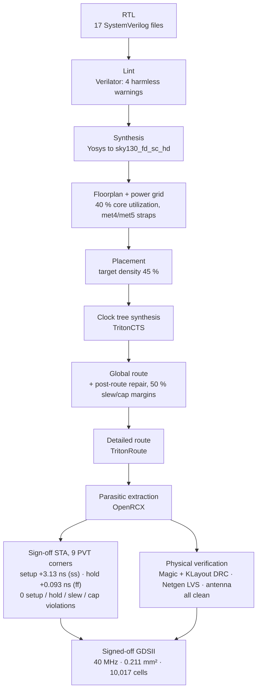

# ASIC Implementation: RV32I Core in SkyWater 130 nm

<table>
  <tr>
    <td align="center">
      <a href="https://ajeeth93.github.io/riscv32i-5stage-pipelined-cpu/layout/"></a><br>
      <b>Metal routing</b><br><sub>met1 blue · met2 red · met3 green · met4 yellow · met5 purple</sub>
    </td>
    <td align="center">
      <a href="https://ajeeth93.github.io/riscv32i-5stage-pipelined-cpu/layout/"></a><br>
      <b>All layers</b><br><sub>diffusion, poly, contacts, li1, metals and vias</sub>
    </td>
  </tr>
</table>

**[Open the interactive layout viewer](https://ajeeth93.github.io/riscv32i-5stage-pipelined-cpu/layout/)**: zoom from the whole die down to single transistors, in a **Metal routing** view and an **All layers** view.

The 5-stage RV32I core was taken from RTL to a signed-off GDSII with the open-source **LibreLane** flow (Yosys + OpenROAD + Magic/KLayout/Netgen) on the **SkyWater sky130A** PDK. It closes timing at **40 MHz with zero setup, hold, slew and capacitance violations at all 9 PVT corners**, and passes DRC, LVS and antenna checks.

## Contents

- [Results at a glance](#results-at-a-glance)
- [What was hardened](#what-was-hardened)
- [Toolchain](#toolchain)
- [Flow](#flow)
- [Constraints (SDC)](#constraints-sdc)
- [Final configuration](#final-configuration)
- [Sign-off: timing at 9 corners](#sign-off-timing-at-9-corners)
- [Sign-off: area, power and physical checks](#sign-off-area-power-and-physical-checks)
- [Timing closure](#timing-closure)
- [Layout viewer: metal routing and all layers](#layout-viewer-metal-routing-and-all-layers)
- [Reproducing the results](#reproducing-the-results)
- [Files](#files)
- [Limitations and next steps](#limitations-and-next-steps)

## Results at a glance

| Metric | Result |
|---|---|
| Technology | SkyWater sky130A, standard cells `sky130_fd_sc_hd` |
| Clock | **25 ns (40 MHz)** |
| Sign-off corners | 9: nom / min / max parasitics × tt / ss / ff |
| Worst setup slack | **+3.13 ns** (`max_ss_100C_1v60`) |
| Worst hold slack | **+0.093 ns** (`max_ff_n40C_1v95`) |
| Setup / hold / max-slew / max-cap violations | **0 / 0 / 0 / 0** at every corner |
| DRC (Magic + KLayout) | Clean |
| LVS (Netgen) | Match |
| Antenna | Pass |
| Die area | 211,001 µm² (≈ 454 × 465 µm, 0.211 mm²) |
| Standard-cell area | 92,430 µm² |
| Utilization | 47.35 % |
| Cells | 10,017 (logic, clock tree and buffers, excluding fill) |
| Power | 8.95 mW (vectorless, default switching activity) |
| Functional check | Testbench passes on the ASIC core: 25 stored to address 100, 25 cycles, CPI 1.316 |

## What was hardened

The hardened block is the **core alone**. Instruction and data memories sit outside it and connect through memory ports, the usual way a CPU core is hardened before caches or SRAM macros are added.

| Port | Width | Direction | Purpose |
|---|---|---|---|
| `clk`, `rst` | 1 | in | Clock, reset |
| `imem_addr` | 32 | out | Instruction address (PC) |
| `imem_rdata` | 32 | in | Instruction |
| `dmem_addr` | 32 | out | Data address (ALU result) |
| `dmem_wdata` | 32 | out | Store data |
| `dmem_rdata` | 32 | in | Load data |
| `dmem_we` | 1 | out | Write enable |
| `dmem_req` | 1 | out | Access request (load or store) |
| `dmem_ready` | 1 | in | Reserved for a future cache stall (not used yet) |

165 pins in total. Differences from the FPGA version in [`RTL Code/`](../RTL%20Code/):

- `RISC_V_Pipeline_Top` exposes memory ports instead of instantiating the memories; `dmem_req = MemWriteM | (ResultSrcM == 2'b01)`.
- The register file's zero-initialisation `initial` block is wrapped in `` `ifndef SYNTHESIS ``.
- Reset styles as synthesized: PC asynchronous, Fetch/Decode and Decode/Execute synchronous clear, Execute/Memory and Memory/Writeback without reset.
- A simulation wrapper, [`sim/riscv_soc.sv`](sim/riscv_soc.sv), puts the core and both memories back together so the original self-checking testbench still runs unchanged.

## Toolchain

| Step | Tool |
|---|---|
| Flow manager | LibreLane 3.0.17 (run with `--dockerized`) |
| Lint | Verilator |
| Synthesis | Yosys |
| Floorplan, PDN, placement, CTS, resizer, routing | OpenROAD (TritonCTS, global route, TritonRoute) |
| Parasitic extraction | OpenRCX |
| Static timing analysis | OpenSTA, 9 corners |
| DRC | Magic and KLayout |
| LVS | Netgen |
| PDK | sky130A installed with Ciel |
| RTL simulation | Vivado 2023.2 xsim |
| Layout viewing and rendering | KLayout, OpenSeadragon (web viewer) |
| Host | Windows laptop, WSL2 Ubuntu + Docker Desktop |

## Flow



The 4 lint warnings are all expected: `dmem_ready` is not used yet, and `lwstall`, `ResultSrcE[1]` and `InstrD[6:0]` are partially unused signals.

## Constraints (SDC)

[`constraint.sdc`](constraint.sdc), used for both place-and-route and sign-off:

```tcl
# RV32I core - sky130 - 40 MHz

# 1. Clock
create_clock -name clk -period 25.0 -waveform {0.0 12.5} [get_ports clk]
set_clock_latency -source -early 0.10 [get_clocks clk]
set_clock_latency -source -late  0.20 [get_clocks clk]
set_clock_uncertainty -setup 0.25 [get_clocks clk]
set_clock_uncertainty -hold  0.10 [get_clocks clk]
set_clock_transition 0.15 [get_clocks clk]

# 2. Drive and load
set in_ports [delete_from_list [all_inputs] [get_ports clk]]
set_driving_cell -lib_cell sky130_fd_sc_hd__buf_4 $in_ports
set_load -pin_load 0.03 [all_outputs]

# 3. I/O budgets
set_input_delay  -max 4.0 -clock clk $in_ports
set_input_delay  -min 2.5 -clock clk $in_ports
set_output_delay -max 4.0 -clock clk [all_outputs]
set_output_delay -min 1.0 -clock clk [all_outputs]

# 4. Exceptions
set_false_path -from [get_ports rst]
set_false_path -from [get_ports dmem_ready]
```

Why these values:

- **Minimum input delay 2.5 ns.** The clock tree delays the flip-flop clocks by about 2.1 ns. With a 1.5 ns minimum input delay, input data reached 22 flops before their own clock edge and violated hold.
- **I/O budget of 4 ns out of 25 ns** on each side leaves the external memories 16 % of the cycle.
- **False paths:** `rst` is treated as quasi-static, and `dmem_ready` is not connected to logic yet.
- **No `set_max_fanout` or `set_max_transition`.** Both were tried and both made timing much worse (see [Timing closure](#timing-closure)).

## Final configuration

[`config.json`](config.json):

```json
{
  "DESIGN_NAME": "RISC_V_Pipeline_Top",
  "VERILOG_FILES": "dir::src/*.sv",
  "CLOCK_PORT": "clk",
  "CLOCK_PERIOD": 25,
  "PNR_SDC_FILE": "dir::constraint.sdc",
  "SIGNOFF_SDC_FILE": "dir::constraint.sdc",
  "FP_CORE_UTIL": 40,
  "PL_TARGET_DENSITY_PCT": 45,
  "RUN_POST_GRT_DESIGN_REPAIR": true,
  "RUN_POST_GRT_RESIZER_TIMING": true,
  "GRT_DESIGN_REPAIR_MAX_SLEW_PCT": 50,
  "GRT_DESIGN_REPAIR_MAX_CAP_PCT": 50,
  "DESIGN_REPAIR_MAX_SLEW_PCT": 50,
  "DESIGN_REPAIR_MAX_CAP_PCT": 50
}
```

| Setting | Why |
|---|---|
| `CLOCK_PERIOD` 25 | 20 ns failed setup at the slow corner by 1.29 ns |
| `FP_CORE_UTIL` 40, `PL_TARGET_DENSITY_PCT` 45 | Leaves room for buffering and routing; final utilization 47 % |
| `RUN_POST_GRT_DESIGN_REPAIR`, `RUN_POST_GRT_RESIZER_TIMING` | Repair slew, cap and timing again once real global routes exist |
| `*_MAX_SLEW_PCT` / `*_MAX_CAP_PCT` 50 | Margin against parasitics that the pre-route estimate underestimates (default 10 %) |

Floorplan, power grid (met4 vertical and met5 horizontal straps) and clock tree use LibreLane defaults.

## Sign-off: timing at 9 corners

Post-route STA with extracted parasitics (`openroad-stapostpnr/summary.rpt`):

| Corner | Setup WNS (ns) | Hold WNS (ns) | Setup / hold violations | Max slew / cap violations |
|---|---|---|---|---|
| max_ss_100C_1v60 | **+3.128** | +0.543 | 0 / 0 | 0 / 0 |
| nom_ss_100C_1v60 | +3.418 | +0.548 | 0 / 0 | 0 / 0 |
| min_ss_100C_1v60 | +3.671 | +0.551 | 0 / 0 | 0 / 0 |
| max_tt_025C_1v80 | +8.902 | +0.214 | 0 / 0 | 0 / 0 |
| nom_tt_025C_1v80 | +8.997 | +0.217 | 0 / 0 | 0 / 0 |
| min_tt_025C_1v80 | +9.099 | +0.220 | 0 / 0 | 0 / 0 |
| max_ff_n40C_1v95 | +10.176 | **+0.093** | 0 / 0 | 0 / 0 |
| nom_ff_n40C_1v95 | +10.234 | +0.097 | 0 / 0 | 0 / 0 |
| min_ff_n40C_1v95 | +10.299 | +0.098 | 0 / 0 | 0 / 0 |

The slow-slow corners set the frequency; fast-fast sets the hold margin. Total negative slack is 0 at every corner.

**Critical setup path:** writeback result → forwarding mux → ALU → 32-bit zero-detect OR tree → branch decision (`PCSrcE`) → next PC. Branches are resolved in Execute from the ALU result, so the branch decision and the PC update share one cycle.

**Frequency headroom (estimate from final slack):** about 45 MHz at ss and about 60 MHz at tt.

## Sign-off: area, power and physical checks

| Check | Result |
|---|---|
| Die area | 211,001 µm² |
| Standard-cell area | 92,430 µm² |
| Utilization | 47.35 % |
| Cell count | 10,017 |
| Total power | 8.95 mW (vectorless estimate, default activity) |
| Magic DRC | 0 violations |
| KLayout DRC | 0 violations |
| Netgen LVS | Netlists match |
| Antenna check | Pass |
| GDS | 13.7 MB (2.9 MB gzipped in [`final/`](final/)) |

## Timing closure

Eight runs over four days took the design from failing to clean. The decisive change was giving the resizer margin against parasitics that it underestimated; the two constraint-based fixes made things worse.

| Run | Change | Worst setup (ss) | Worst hold | Max slew / cap violations |
|---|---|---|---|---|
| 1 | Synthesis only, 20 ns | – | – | – |
| 2 | First full run: 20 ns clock, min input delay 1.5 ns | −1.29 ns (776 paths) | −0.077 ns (22 I/O paths) | 804 / 34 |
| 3 | 25 ns clock, min input delay 2.5 ns | +1.28 ns | +0.099 ns | 876 / 37 (ss) |
| 4 | + `set_max_fanout 10` + `set_max_transition 1.0` | −5.21 ns (918 paths) | +0.102 ns | 1,875 / 51 |
| 5 | `set_max_fanout 10` only | −4.84 ns (917 paths) | +0.098 ns | 1,172 / 125 (ss) |
| 6 | Run 3 SDC + post-global-route design and timing repair | +1.42 ns | +0.094 ns | 887 / 37 (ss) |
| 7 | + 50 % slew/cap margins in post-global-route repair | +1.59 ns | +0.096 ns | 556 / 26 (ss) |
| 8 **(sign-off)** | + 50 % slew/cap margins in pre-route repair | **+3.13 ns** | **+0.093 ns** | **0 / 0** |

**What happened:**

1. **50 MHz did not fit.** At 20 ns the forwarding → ALU → zero-detect → branch path failed setup at ss by 1.29 ns, so the clock was relaxed to 25 ns.
2. **Hold failed on 22 input paths.** The clock tree adds about 2.1 ns of insertion delay at the flops, so data with a 1.5 ns minimum input delay arrived before the capturing clock. Raising the minimum input delay to 2.5 ns fixed it.
3. **About 880 slew and 37 cap violations remained at the slow corner.** They clustered on the register-file read-decode nets, for example an `or4_2` driving 32 loads and a `nor2_4` driving 17 loads. A NOR gate's rising edge is slow because of its series PMOS stack.
4. **Tightening constraints backfired.** `set_max_transition` and `set_max_fanout` made the resizer insert buffers everywhere; setup fell to about −5 ns and slew violations doubled.
5. **A wrong hypothesis was ruled out.** The resizer was suspected of seeing fewer corners than STA, but it uses all 9.
6. **Root cause: optimistic estimated parasitics.** Post-route repair initially fixed 0 of 7,178 nets, and the log showed about 2,000 "missing route to pin" estimation warnings. Repair before routing judged slew on estimated wire RC; the real routes were longer, so nets that looked fine failed after routing.
7. **Fix: margins.** 50 % slew/cap margins in post-route repair cut the violations to 556 / 26; adding the same margins before routing took them to 0 / 0.
8. **Setup improved as a side effect**, from +1.59 to +3.13 ns, because sharper edges also shorten downstream cell delays.

**Lessons:** over-constraining design-rule limits makes the resizer chase symptoms with buffers; when repair cannot see a problem, check which parasitics it is using; slew closure and timing closure are coupled; and the high-fanout nets come from the register-file architecture, so the lasting fix is in RTL or floorplan, not in constraints.

## Layout viewer: metal routing and all layers

**[ajeeth93.github.io/riscv32i-5stage-pipelined-cpu/layout](https://ajeeth93.github.io/riscv32i-5stage-pipelined-cpu/layout/)**

| View | Layers | Purpose |
|---|---|---|
| **Metal routing** | met1 blue, met2 red, met3 green, met4 yellow, met5 purple (solid) | Routing and power grid, Innovus-style colours |
| **All layers** | nwell, diff, tap, poly, contacts, li1, met1–met5 and vias (hatched metals) | Transistor-level detail inside the standard cells |

What to look for:

- **Power grid:** three vertical met4 strap pairs (yellow) and three horizontal met5 strap pairs (purple) feed the met1 rails of every standard-cell row.
- **Signal routing:** met2 (red) carries most vertical routing and met3 (green) the horizontal; met4 carries only a few long signal routes.
- **Pins:** the memory-port pins sit on the top, bottom and right edges.
- **All layers, zoomed in:** diffusion and poly form the transistors; li1 and met1 wire them inside each cell.

How it is built: KLayout renders the GDS into 256 × 256 px WebP tiles at every zoom level ([`make_deepzoom.py`](make_deepzoom.py)), and [OpenSeadragon](https://openseadragon.github.io/) loads only the tiles in view. Full zoom is 16,384 px across the die, about 28 nm per pixel, with 5,661 tiles per view. The page lives in [`docs/layout/`](../docs/layout/) and is served by GitHub Pages.

## Reproducing the results

Requirements: Linux or WSL2, Docker, Python 3.10+, LibreLane 3.x (`pip install librelane`). The sky130A PDK is fetched automatically on the first run.

```bash
# from the repository root
python3 -m librelane --dockerized asic/config.json
```

Results land in `asic/runs/<RUN_TAG>/` (git-ignored). Useful outputs:

```bash
cat asic/runs/<RUN_TAG>/*-openroad-stapostpnr/summary.rpt   # 9-corner timing summary
ls  asic/runs/<RUN_TAG>/final/                              # gds, netlist, sdf, spef, metrics.json
```

View the signed-off layout in KLayout with Innovus-style colours:

```bash
./asic/open_layout.sh
```

Regenerate the web viewer tiles (needs KLayout's Python module and Pillow):

```bash
python3 asic/make_deepzoom.py asic/final/RISC_V_Pipeline_Top.gds.gz asic/innovus.lyp        docs/layout metals 16384
python3 asic/make_deepzoom.py asic/final/RISC_V_Pipeline_Top.gds.gz asic/innovus_detail.lyp docs/layout detail 16384
```

Simulate the ASIC core: use `sim/` as simulation sources and `src/` as design sources in Vivado, with `testbench` as the simulation top.

## Files

```
asic/
  src/                      17 SystemVerilog files of the hardened core
  sim/                      riscv_soc wrapper, memories, testbench, program
  config.json               LibreLane configuration (signed off)
  constraint.sdc            timing constraints (signed off)
  final/
    RISC_V_Pipeline_Top.gds.gz   signed-off GDSII
  innovus.lyp               KLayout colours, metals only (Innovus style)
  innovus_detail.lyp        KLayout colours, all layers
  open_layout.sh            open the GDS in KLayout with innovus.lyp
  render_innovus.py         render a PNG of the layout
  make_deepzoom.py          render deep-zoom tiles for the web viewer
docs/
  layout/                   web viewer (index.html, metals and detail tiles)
  img/chip_innovus.png      layout preview image
```

## Limitations and next steps

Honest scope of this first sign-off:

- **40 MHz is modest** for RV32I in sky130; the design is not yet optimized.
- **No gate-level simulation with SDF yet**, so correctness with real delays is not demonstrated.
- **Power is a vectorless estimate**, not a workload-based number.
- **Floorplan, power grid and clock tree use tool defaults**; the IR-drop report has not been analysed.
- **Memories are outside the core.**
- **Signal-integrity (crosstalk) analysis** is not available in OpenSTA.

Planned work:

- [ ] IR-drop analysis and a justified power-grid design (strap pitch and width versus worst drop)
- [ ] Clock-tree analysis: skew, insertion latency, buffer count
- [ ] RC-correlation study: slack and slew at placement estimate, global route and extracted SPEF
- [ ] Hand floorplan with pins grouped by function; utilization sweep
- [ ] Gate-level simulation with SDF at ss and ff
- [ ] Workload-based power from a VCD
- [ ] Dedicated branch comparator off the ALU path; target about 50 MHz at ss
- [ ] Integration with the [direct-mapped write-back cache](https://github.com/Ajeeth93/direct-mapped-writeback-cache) and SRAM macros
